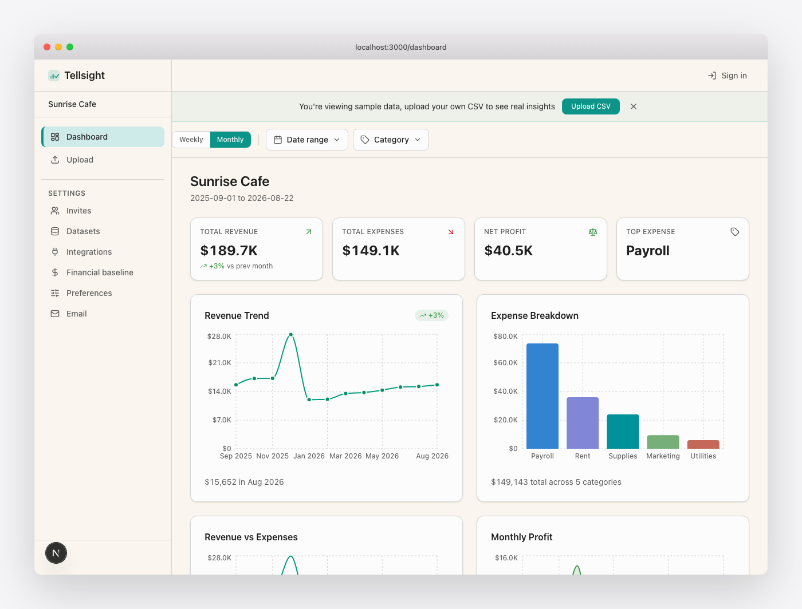
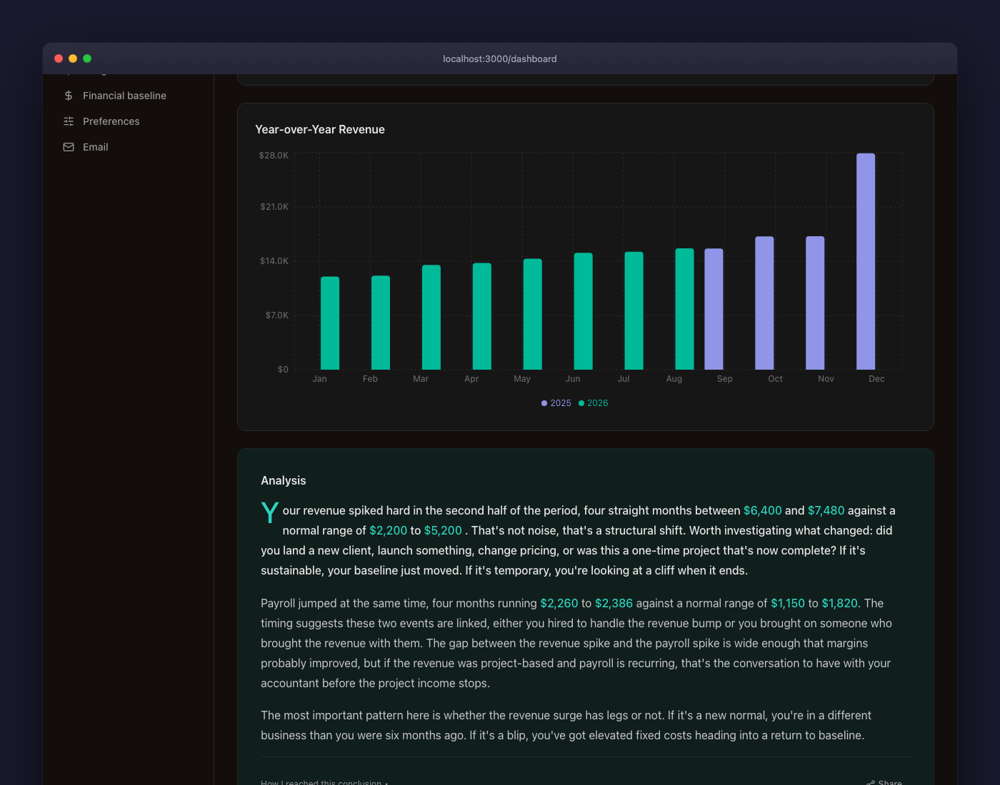
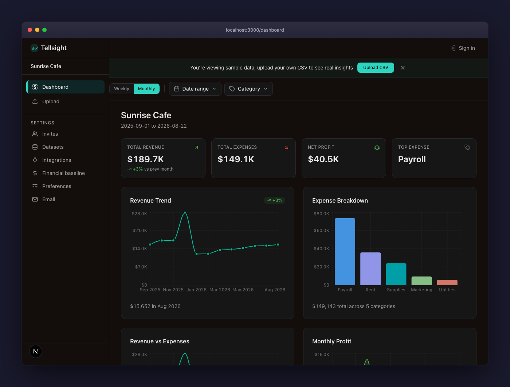
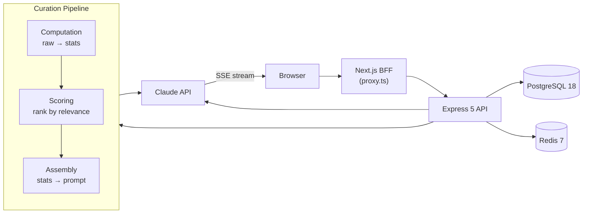

<p align="center">
  
</p>

<p align="center">
  <a href="https://tellsight.coreystevens.dev"></a>
  <a href="https://github.com/coreystevensdev/tellsight/actions/workflows/ci.yml"></a>
  
  
  
  
</p>

## Overview

Most analytics tools show you numbers. This one tells you what they mean, and emails you the explanation every week.

Connect QuickBooks, Xero, a business bank account, Shopify or Square, or upload a CSV. You get charts, and then a plain-English reading of what actually changed and what it implies for the business. The AI only ever sees computed statistics, never your raw transactions.

**[Try it](https://tellsight.coreystevens.dev)**, no signup: the dashboard loads with sample data and a real AI summary. Signing up gives you your own organization seeded with the same twelve months, and Stripe runs in test mode, so `4242 4242 4242 4242` with any future expiry reaches Pro and the full-length interpretation without a real charge.

Under the hood: multi-tenant Postgres with row-level security enforced in the database rather than the application, SSE streaming for AI summaries, a four-queue BullMQ digest pipeline, Stripe billing. Deployment topology is in [Architecture](#architecture); the Terraform runbook is in [infra/README.md](infra/README.md).

<sub>The badge counts what the suites executed, not what they collected, which under vitest 5 are different numbers. The mobile layout spec runs under both Chromium and WebKit, so eleven of the Playwright tests are a second copy rather than new coverage. The curation pipeline's financial math is the most heavily covered.</sub>

## If you only read one thing

This README is long because the measurement is the point, and that makes the
interesting parts easy to miss. Three places, in the order I would read them:

- **[Known limitations](#known-limitations)** is thirteen named gaps, each with a
  mechanism rather than a hedge. A revenue-only connector still produces a wrong
  cash-flow figure and the entry explains why it is still rendered. Backup
  retention is capped at one day and the entry says what that costs. If you read
  one section to decide whether the rest is honest, read this one.
- **[Eval harness](#eval-harness)** is how the summaries are graded, including a
  judge model deliberately different from the subject and a test that pins the
  subject to whatever the deploy script ships. The measurement history, and the
  three times a published figure turned out to be wrong, is in
  [docs/eval-history.md](docs/eval-history.md).
- **[How this was built](#how-this-was-built)** is what the model got wrong and
  what caught it: a check I wrote that was itself wrong, the validation that
  strips hallucinated stat references before anything is cached, and a rate I
  published three times before it was right.

The one-line version of the architecture: the function that assembles the prompt
accepts computed statistics and will not accept data rows, so the privacy
boundary is a type signature rather than a code-review habit.

## Problem

Small businesses can't afford data scientists, and enterprise analytics platforms overwhelm non-technical users with dashboards full of numbers but no guidance. The gap isn't visualization. Plenty of tools make charts, and QuickBooks will already draw you a revenue line. The gap is interpretation: revenue is up 8% and margin is down 3%, so which one should I care about this month, and what do I do about it?

This section used to open with a Federal Reserve statistic about financial stress. It is gone because I could not source it: the Fed publishes the Small Business Credit Survey, not a "Small Business Survey", that survey reports on financing conditions rather than felt control, and every trail for the specific figure led to a blog citing the Fed rather than to the Fed. An unsourceable number in the Problem section is worse than no number, because it is the first thing a skeptical reader checks.

## Solution

Upload a CSV or connect QuickBooks, Xero, a bank account, Shopify or Square directly (six supported data sources today; there is no Stripe-as-a-data-source connector). A CSV keeps whatever column names the exporting tool wrote, so Square, QuickBooks and Shopify exports are matched under their own headers rather than being renamed by hand first. The dashboard instantly visualizes revenue trends, expense breakdowns, and category comparisons. Then AI reads the computed statistics (not your raw data) and explains what's happening in plain English: which costs are rising faster than revenue, where seasonal patterns suggest opportunities, what anomalies deserve attention. Connected users skip the CSV export entirely. Pro users get that interpretation delivered as a weekly email digest, with week-over-week context built in, so the analysis arrives without having to remember to log in.

## Features

<p align="center">
  
</p>

<p align="center">
  
</p>

<p align="center">
  
</p>

- **Streaming AI summaries.** Claude reads the computed statistics and explains what matters. Summaries stream in real time via SSE so the user sees output as it generates.
- **Stripe billing.** Free tier with a 50-word AI preview, Pro tier for full summaries. Reviewing this? Pro is reachable without paying for it, see Known limitations for the code. The checkout, the webhook and the tier transition are all the real ones; only the amount is zero.
- **Row-level security.** Org-first multi-tenancy with PostgreSQL RLS policies on every table.
- **Shareable insights.** Generate PNG snapshots or shareable links for team collaboration.
- **Dark mode.** System preference detection + manual toggle with oklch color tokens.
- **Demo mode.** Pre-loaded seed data with cached AI summary, zero configuration needed.
- **QuickBooks and Xero integrations.** Connect either accounting platform via OAuth and sync directly. The same curation pipeline that reads CSVs reads both; same privacy guarantees apply. These two and the bank feed are the sources that see operating costs, so they are what makes a margin figure mean anything: `SEES_OPERATING_COST` marks Shopify and Square as revenue-only and suppresses margin rather than reporting ~97% for a store whose real margin is a fifth of that. Suppressing it silently was its own problem, so a revenue-only org is now told which insights its connector cannot support and why, on the dashboard and in the digest.
- **Bank account connection.** Link a business bank account to pull transactions and the current balance. The balance is what makes runway and cash-forecast computable at all, since both read a cash-on-hand figure that otherwise only exists if an owner types it in.
- **Weekly email digest.** Pro users get a plain-English summary delivered weekly. Each digest carries prior-week context (via `digest_history`) and is tone-calibrated by a valence classifier: a positive week reads differently than a warning week, so the copy matches the underlying signal rather than always defaulting to neutral.
- **Show-me-math audit drawer.** Every AI-generated claim carries an inline `<cite id>` token; clicking it opens a drawer showing the exact computed stat and the source rows behind it, so a summary is never just a paragraph to take on faith.
- **Ask a question.** Agent-tier users can ask a direct question about their own numbers and get an interpreted answer back, cited into the same audit drawer. A bounded tool-calling loop (capped turns, capped cost) reads only computed statistics, never raw rows, and a lookup-vs-interpretation eval gates the feature against degrading into a bare-number lookup bot.

## Architecture



The browser never talks to Express directly. Everything routes through a Next.js BFF proxy (same-origin, no CORS). The curation pipeline computes statistics locally, scores them by relevance, then assembles a prompt from the top insights. Raw data never reaches the LLM. Only computed statistics. This privacy-by-architecture approach means the AI interprets trends and anomalies without ever seeing individual rows.

The Claude integration calls `@anthropic-ai/sdk` directly rather than going through a framework like LangChain, behind a small in-house provider seam that owns retries, a circuit breaker, a cost gate, and prompt caching. The reasoning is written up in [ADR 0001](docs/adr/0001-anthropic-sdk-over-langchain.md).

### Eval harness

An offline eval harness grades the summaries that come out: three labeled financial fixtures (healthy-growth, cash-crunch, seasonal-anomaly) run through the full pipeline and are judged for faithfulness (no invented figures), completeness (covers the stats that matter), and legal posture (analytics framing, not financial advice). Faithfulness and completeness use LLM judges via the shared provider; legal posture is a deterministic string scanner with 33 tests, run via `pnpm test:eval`, separate from CI. Run the full harness with `pnpm eval`. Its subject defaults to `claude-sonnet-4-6`, the model production serves, and its judge to `claude-sonnet-5`, deliberately a different one so nothing grades its own output; both are overridable with `EVAL_MODEL` and `EVAL_JUDGE_MODEL`, and a test pins the subject to the model the deploy script actually ships. A fourth judge grades the non-obvious-and-actionable insight the product commits to (see Known limitations for the rate).

**The numbers, and the three times a published one was wrong.** The measurement history is in [docs/eval-history.md](docs/eval-history.md): what each run read, where a floor breach turned out to be sampling noise quoted as a finding, the four-arm ablation that found two of three changes worth nothing and the third worth all of it, and the re-run with a third judge where a self-graded arm's advantage changed sign. The current reading is 0.943 aggregate faithfulness across 87 samples on the model production serves, completeness 1.00, legal posture clean.

**A second track for Q&A.** A second track, `pnpm eval:qa`, grades the Q&A tool's lookup-vs-interpretation bias with a `claude-sonnet-5` judge (also overridable with `EVAL_JUDGE_MODEL`), backed by a deterministic numeric-figure guard covered by `interpretation-guard.test.ts` (12 tests). Its committed snapshot records 1.00 aggregate accuracy across all 8 fixtures against a floor of 0.85, measured 2026-08-02 on `claude-sonnet-4-5-20250929`. The eval:qa track doesn't run in CI either.

A separate agent pass runs on the same computed statistics using dedicated prompt templates, producing structured proposals with severity tiers (`info`, `notice`, `warning`, `critical`) and finding kinds (`reconciliation`, `trend`, `anomaly`, `threshold`). The `validateProposalCandidate` validator filters raw LLM output: schema-invalid proposals are dropped individually, proposals that cite stat IDs outside the allowedStatIds set are rejected, and the rest form a partial result rather than failing the whole call. A pure routing gate in `packages/shared` assigns each surviving proposal to `auto_notify`, `needs_approval`, or `suppress` based on four rules in priority order: confidence below floor suppresses; a mutating action or over-threshold financial impact routes to human approval; a dedupKey seen within the suppression window suppresses; otherwise auto-notify. Advisory posture is enforced at the contract boundary: the DIRECTIVE regex on `explanation` and `recommendation` rejects phrasing like "you should" at schema validation time rather than at content review time. A nightly BullMQ job runs the pass per Agent-tier org, and `needs_approval` findings land in an in-app Action drawer where only org Owners can approve or reject; approving writes an audit row, and pending items expire after 14 days rather than accumulating into an ignorable inbox.

A third eval track, `pnpm eval:proposals`, measures the gate itself: a hand-labeled set of `AgentProposal` fixtures runs through the real `routeProposal()` with no LLM call, and precision is computed over the fixtures the gate routes to `needs_approval` (of those, what share were labeled worth a human's time). The current measured precision is 0.8 (4 of 5 needs_approval fixtures). Unlike the other two eval tracks, this one is CI-gated: the `proposal-precision-eval` job fails the build if a change drops precision below the committed snapshot baseline.

## Tech stack

| Layer | Technology | Why |
|-------|-----------|-----|
| Frontend | Next.js 16, React 19.2, Tailwind CSS 4 | Turbopack for fast dev, RSC for server-rendered dashboard |
| Backend | Express 5, Node.js 22 | Auto promise rejection forwarding, mature middleware ecosystem |
| Database | PostgreSQL 18, Drizzle ORM 0.45.x | RLS for multi-tenancy, Drizzle for type-safe queries |
| Cache | Redis 7 | Rate limiting + AI summary cache |
| AI | Claude API with SSE streaming | Structured prompt engineering, streaming delivery |
| Auth | JWT + refresh rotation, Google OAuth or email/password (jose 6.x, scrypt) | Secure token lifecycle, social login and password-based signup both onboard into the same session |
| Monorepo | pnpm workspaces, Turborepo | Shared schemas between frontend/backend |
| Testing | Vitest, Playwright | Fast unit tests, browser-based E2E and screenshots |
| CI/CD | GitHub Actions, 11 jobs | Lint, secret scan, four test suites, seed validation, proposal-precision eval, E2E, Docker smoke, and a test-count job that fails main when the README badge disagrees with what the suites ran |
| Infrastructure | AWS EC2 t3.micro, RDS PostgreSQL 18, Redis 7 (co-located container) | Smallest sizes that run it: `db.t3.micro`, single-AZ, one-day backup retention. Docker Compose on EC2 trades HA for cost. Earlier this row claimed `$0/month for 12 months`, which was an account-plan fact with no start date and no longer true |
| IaC | Terraform 1.9, GitHub OIDC (no long-lived keys) | Reproducible infra, scoped IAM roles for CI |

## Getting started

### Prerequisites

- [Docker](https://docs.docker.com/get-docker/) and Docker Compose

### Quick start

```bash
# 1. Clone the repo
git clone https://github.com/coreystevensdev/tellsight.git
cd tellsight

# 2. Create your env file
cp .env.example .env
# Edit .env, most defaults work for local dev
# CLAUDE_API_KEY is optional: seed data includes a pre-generated AI summary

# 3. Start the full stack
docker compose up
```

The app starts at [http://localhost:3000](http://localhost:3000) with seed data pre-loaded. The dashboard shows charts and an AI summary immediately, no account needed.

Observability stack starts alongside the app:
- Prometheus scrapes the API at `:9090`
- Grafana dashboard (HTTP latency percentiles, AI token rate, SSE streams) at `:3002` (login: admin/admin)

### Local development

```bash
pnpm install
pnpm dev          # Start all services via Turborepo
pnpm lint         # Lint all packages
pnpm type-check   # TypeScript check
pnpm test         # Run all tests
pnpm screenshots  # Regenerate README assets via Playwright
```

### Resetting local data

```bash
bash scripts/reset-local.sh
```

Drops the Postgres and Redis volumes, rebuilds, migrates, reseeds, then checks
that `public.users` actually exists before reporting success. Use it when local
state has drifted somewhere you cannot reason about. It prompts before deleting
anything; `--yes` skips that, `--down` tears down without rebuilding.

The schema check at the end is not belt and braces. `/health/ready` runs
`SELECT 1`, which passes against a database with no tables in it at all, so a
green readiness probe is not evidence that a reset worked.

### Calling the API directly

[`docs/api.md`](docs/api.md) has curl examples for every major route, valid and
invalid, with real responses. Two things worth knowing before the first request:
there is no `/api` prefix on Express (that belongs to the Next.js proxy), and
auth is httpOnly cookies rather than a bearer header, so curl needs a cookie
jar.

## Demo

The app ships with seed data: 12 months of synthetic business data across 6 categories (Revenue, Payroll, Marketing, Rent, Supplies, Utilities) with a pre-generated AI summary. No API keys, no accounts. Just `docker compose up` and open the dashboard.

The AI summary highlights the December revenue spike, Q3 marketing dip, October payroll anomaly, and steady rent baseline. That's the kind of thing the curation pipeline surfaces from real-ish data.

## Project structure

```
apps/web/          Next.js 16 frontend (port 3000)
apps/api/          Express 5 API (port 3001)
packages/shared/   Shared schemas, types, constants
scripts/           CI tools (seed validation, screenshot generation, AI summary eval harness)
e2e/               Playwright E2E tests
```

## Distributed systems patterns

The weekly digest pipeline illustrates several patterns that come up in high-throughput background systems.

**Four-queue BullMQ architecture.** A single shared queue with multiple worker types fails under BullMQ OSS because workers compete for jobs randomly and a processor that early-returns marks the job complete, hiding it from other workers. Four named queues (orchestrator, org, send, nudge) give independent concurrency per job type: 1 orchestrator, 3 per-org workers, 10 send workers, 3 nudge workers. Independent concurrency lets the send tier scale without affecting the orchestration tier.

The nudge queue is the one whose separation is not about throughput. It tells an org once when its weekly digest stops arriving, so it fires at most once per org per staleness episode and is never the hot path. It gets its own queue because the send worker carries a rate limiter, and a burst of nudges sharing that budget would delay the digests themselves.

**Deterministic job IDs.** Org jobs use the id `digest-org-{orgId}-{weekStartMs}` and send jobs `digest-send-{userId}-{weekStartMs}`, passed as the `jobId` option rather than only as the job name. That distinction is the whole mechanism: BullMQ dedupes on `jobId`, and `name` is just a label, so naming jobs without setting `jobId` looks like a dedup key and is not one. A retried orchestrator attempt would have re-enqueued every org. With the id set, a retry or a cron double-fire never produces duplicate sends. This is defense-in-depth alongside the DB-level cache check.

**Cache-first per-org handler.** Before invoking the curation pipeline or Claude, the per-org handler checks `aiSummariesQueries.getCachedDigest(orgId, datasetId, weekStart)`. If a summary row already exists (from a prior run, a manual trigger, or a retry), the LLM call is skipped entirely. The cost gate and the duplicate-send prevention both collapse to this single DB read.

**Exponential backoff with retry budget.** Org jobs get 3 attempts at 30s base delay; send jobs get 3 attempts at 30s base delay. Failed jobs are retained for 30 days (`removeOnFail: { age: 30 * 86_400 }`). The `attachSendFailedAnalytics` listener only fires the `digest_failed` event after all retries are exhausted, so the compliance dashboard distinguishes transient provider errors from terminal failures.

**Send-side rate limiter.** The send worker is initialized with `limiter: { max: 10, duration: 1_000 }`, capping outbound mail at 10/sec in-process. Combined with Resend's plan-tier limit and a retry-classified 429 path, this is a two-layer defense against mail provider throttling.

**Partial batch tolerance.** If enqueueing a per-org or per-send job fails (rare Redis blip), the orchestrator logs the failure with `orgId` and continues. A partial batch is better than no batch. DB errors during eligibility lookup propagate and trigger a BullMQ retry on the orchestrator job itself, because those are recoverable infrastructure failures, not acceptable partial states.

**Circuit breaker on the Claude API client.** Wraps every interpretation call in a closed/half-open/open state machine with configurable failure threshold and cooldown. Opens on consecutive failures, sends a probe on the next request after cooldown, resets on success. The state is exported to a Prometheus gauge (`circuit_breaker_state`) so Grafana can alert before users see errors.

**PostgreSQL row-level security.** Every table has RLS policies driven by session variables (`app.current_org_id`, `app.is_admin`) set via `SET LOCAL` inside a transaction. The `withRlsContext` wrapper validates orgId as a finite integer before interpolating into the `SET LOCAL` statement (safe from injection). Queries without a valid RLS context return empty results rather than throwing, so a misconfigured path fails closed.

**k6 load test SLOs.** `k6/load-test.js` enforces: p95 latency across all routes < 2s, p99 < 5s, error rate < 0.5%, health endpoint p95 < 300ms, datasets endpoint p95 < 800ms. Baseline (local docker-compose, 2026-07-05, 10-50 VUs): all-routes p50 ~25ms / p95 ~120ms / p99 ~280ms; /health p95 ~8ms; /api/datasets p95 ~180ms. All SLO thresholds pass. Run locally with `k6 run k6/load-test.js` (requires a running stack and a `K6_JWT_TOKEN` env var).

## How this was built

AI assistance was used, which is worth stating plainly because the interesting part is not that a model wrote code, it is what had to be built around the model to make its output safe to ship. Three of those are in this repo and all three came out of catching it being wrong.

**A check I wrote that was wrong, and the narrow fix.** The legal-posture scanner flagged a cash-crunch summary for the phrase "you need to". Reading the sample, the sentence was "the gap between what you're earning and what you need to break even", which names a figure rather than telling anyone to do anything. A substring match cannot tell those apart. The fix in `packages/shared/src/agent/constants.ts` is a negative lookbehind on eleven descriptive markers (`what`, `than`, `when`, `if` and so on) applied to that one phrase only, so "you need to cut costs" still trips and every other banned phrase is untouched. The eval now calls the same matcher production calls rather than rebuilding the regex from the shared list, because the two had already drifted once.

**Validation the model cannot talk its way past.** `validateStatRefs` checks every stat ID in a generated summary against the stats that were actually in the prompt, and `stripInvalidStatRefs` removes the ones that were not before anything is cached. The proposal schema goes further and rejects outright: `hasDirectiveLanguage` is a Zod `.refine()` on both the explanation and the recommendation fields, so a proposal with directive language never becomes an object. Asking the prompt for advisory language is a request; these are the guarantee.

**A number I published three times before it was right.** The rate of summaries carrying no non-obvious insight was reported as 1 in 35, corrected to 1 in 16, briefly reported as 1 in 35 again, and settled at 1 in 22 with a 95% interval of 2.2% to 9.0% only after a pre-committed 50-sample arm came back worse than the three before it. The failure mode was the same every time: an early arm lands low and gets quoted as though the interval around it were narrow. Known limitations below keeps that history rather than the final number alone, because the history is the useful part.

Where AI assistance is least visible is the eval harness itself, which exists because a model will produce a confident summary of nothing at all and the only way to know is to grade it against fixtures with known answers.

## Known limitations

A few honest gaps:

- **Stripe runs in test mode, deliberately.** Gating the AI interpretation behind a paywall nobody reviewing this will pay is self-defeating, and a demo that charged a real card would need business registration, tax handling and refund obligations to be real too. So `4242 4242 4242 4242` reaches Pro. Everything either side of the card is the production path: the same hosted checkout, a real `checkout.session.completed` with its signature verified, and the same free-to-Pro transition a paying customer takes. `config.ts` refuses a test key in production unless the deployment says it means it, and the boot check reports which mode it is actually in at `/api/health` rather than trusting the key prefix.

- **The connectors run against test accounts, not a real business.** QuickBooks and Square use their sandbox environments. Shopify has no sandbox, so it runs against a development store, a real store Shopify gives developers for free. The deployed instance has credentials for QuickBooks, Shopify, Square and Xero, with live connections to QuickBooks, Shopify and Xero, all syncing on a daily cron. Square is configured but not connected. The bank feed is the only connector with no credentials set at all. Everything around the credentials is the production path: OAuth with state and HMAC verification, webhook signature checks, token refresh against the provider's live endpoint. `SQUARE_ENVIRONMENT` and `QUICKBOOKS_ENVIRONMENT` move to production with no code change. Pointing any of them at a live seller account would put a real business's revenue on one free-tier instance for a benefit no visitor could see, since signed-out visitors are served synthetic seed data and the connector routes require a session.

- **The CSP allows inline script, and that is a decision rather than an oversight.** `script-src` carries `'unsafe-inline'`. What it covers is three framework-generated inline blocks on a page that otherwise loads 17 external chunks, one of them Next's hydration payload. Removing it means a per-request nonce, which Next can only mint in middleware, which widens `proxy.ts` from the 5 routes it matches to all 24 page routes and opts 21 of those 24 out of static rendering on a single t3.micro. It also moves the whole policy out of build-time config, leaving a matcher exclusion regex to decide which paths get a CSP at all. So the policy does not stop an injected inline script; it removes what one would do next, with `connect-src 'self'`, `form-action 'self'`, `base-uri 'none'` and `object-src 'none'`, and `dangerouslySetInnerHTML` appears nowhere in the web app. The measurements and the fail-open trap that makes a half-finished nonce migration worse than this are in [ADR 0002](docs/adr/0002-csp-unsafe-inline-over-nonces.md).
- **Synthetic seed data only.** The 12 months of demo data are generated to exercise the pipeline; real CSVs with unusual category mixes or column names may surface edge cases the seed doesn't cover.
- **Curation pipeline scoring is heuristic.** The "rank by relevance" step uses hand-tuned weights, not a learned model. Fine for the demo dataset; real datasets may need re-weighting per industry.
- **Free-tier AI preview is capped at 50 words.** `FREE_PREVIEW_WORD_LIMIT` in `packages/shared/src/constants/index.ts`, enforced in `streamHandler.ts` against the accumulated text as each delta arrives, which makes 50 a floor and not a ceiling: the stream stops on the first chunk that crosses it, and whatever that chunk contained is already delivered. How far past 50 a given reader lands is a property of the provider's chunk size, not of this code, so the `upgrade_required` event carries the real count rather than the limit. In practice Claude's deltas are small and the overshoot is a few words; a provider that answered in one large chunk would hand the free tier the whole summary. Enough to judge whether the interpretation is any good, and a hard ceiling that Pro removes. This README claimed ~150 until 2026-10-18, which was wrong for as long as the number has been 50; `scripts/readme-free-preview-sync.test.ts` now pins the sentence to the constant so the two cannot drift again.
- **A revenue-only connector still produces a cash-flow figure, and that figure is wrong.** Shopify and Square report sales and refunds, so `cash_flow` nets sales against refunds and reports something close to revenue, with rent and payroll invisible to it. Margin and break-even are suppressed for exactly this reason and the owner is told so; cash flow is not, because suppressing a stat that currently renders changes what existing orgs see and that is a product call rather than a bug fix. Found by writing the test that pins which insights a revenue-only dataset actually loses, which is also what showed the original three-insight claim counted one that was merely absent for want of months.
- **Six data sources in code, and the bank feed is the only one a visitor cannot exercise.** QuickBooks, Xero, Shopify, Square, a bank feed and CSV upload. Each connector reads its own credentials from config, so a deployment that has not set them hides that connector, and the bank feed is the one with none set. Xero was in that state too until 2026-11-19, and this section still said so for a day after it stopped being true. Square reads sales and refunds across every location on the account; it does not read inventory the way the Shopify connector does. The two accounting connectors do not overlap in what they fetch: Xero deliberately skips Payments, because a Xero payment settles an invoice already counted and fetching both would report the same revenue twice.
- **Chart rendering serializes to concurrency 1 per process.** `renderChart.ts` queues every render through one module-level queue: `react-dom/client` reads `window`, `document`, and `navigator` off `globalThis`, so the module installs a jsdom shim there per render and two renders can't safely overlap. That's well below the `alerts-send` worker's declared concurrency of 10, and each render also builds a fresh, uncached `Resvg` instance with `loadSystemFonts: true`, adding real per-render font-loading cost on top.
- **The expired-proposal fold-in recovers three missed digest weeks, not more.** The fold-in reaches back 28 days from the digest's week start, so proposals expired during a run that never completed still surface in a later one. `status` is what prevents a double send: a proposal goes `expired` to `notified` only when a digest carrying it is delivered. Past four weeks the window drops them, deliberately, since a two-month-old expired finding is noise rather than news. The previous behaviour anchored the window to each week's own start, which lost them after a single missed run.
- **The agent checks its own figures but not its own direction or window.** Every number in a proposal is re-derived against the computed stats before it is kept, and a proposal quoting a figure the stats cannot produce is dropped rather than flagged, which this path can do because a proposal is a complete object before anything uses it. What is not checked is whether a stated direction agrees with the stat, or whether a named window matches the one the stat covers. That is not an oversight waiting on effort: direction is modelled three different ways across the stat types (`'above' | 'below'`, `'expanding' | 'shrinking' | 'stable'`, `'burning' | 'surplus'`) and nine of the twelve carry no direction field at all, so a shared up-or-down vocabulary would be a judgment call dressed as a translation, and a proposal connecting two stats can correctly describe opposite movements. The design that does work, having the model echo the stat's own token for code to compare literally, plus why the window gets no equivalent, is in [ADR 0003](docs/adr/0003-direction-checks-echo-the-stat-token.md). That document asked to be revisited once the eval arm had a baseline, and the first one came back with the check firing zero times in 67 tool calls while a second rule beside it deleted 19 correct runway findings over an optional field. Stating an unverifiable direction now clears that field instead of the proposal; contradicting a cited stat still drops the whole thing. The numbers and why the two cases are treated differently are in [ADR 0004](docs/adr/0004-movement-present-when-absent-clears-the-field.md).
- **The live AI summary can't be blocked from delivering directive language, only flagged after the fact.** The eval harness has flagged real ones, though the first hit it reported turned out to be a descriptive clause the substring matcher could not tell from a directive. The agent-proposal pipeline can reject this at the schema boundary because a proposal is a complete object before it's ever used; a summary streams token by token as it generates, so by the time the full text is assembled and checked, it has already reached the browser. `streamHandler.ts` now runs the same `hasDirectiveLanguage` check every other summary validator uses (unknown stat refs, unknown citations, unmatched figures) and logs + tracks an analytics event when it fires, but "flag it" is the ceiling for a streamed response; true blocking would mean buffering the whole generation before sending any of it, trading away the streaming UX to close a rare edge case.
- **About one summary in twenty-two carries no insight that is both non-obvious and actionable.** The product commits to at least one per analysis, and until recently nothing measured it: the eval graded whether claims were true and whether the stats were covered, and a summary can score full marks on both by restating every figure and suggesting nothing. A judge for it now runs in the harness. Measured at 7 misses in 155 generations on the deployed v2.0 prompt, 4.5%, 95% CI 2.2% to 9.0%. That figure has been revised down twice and up once, and the revisions are the most useful thing in this section. It was first reported as 1 in 35 off a single 35-sample run, then corrected to 1 in 16 when a second run pooled to 6 in 95, then briefly reported as 1 in 35 again off 105 samples, and settled at 1 in 22 only after a pre-committed 50-sample arm came back worse than the three before it, which had read 8%, 0% and 5%. A single run of this eval does not pin a rate, and the failure mode is always the same: an early arm lands low and the number gets quoted as though the interval around it were narrow. The concentration was real, though. v1.9 missed 15.6% on the cash-crunch fixture against 2.5% elsewhere, traced to the cash-flow rule offering "worth reviewing with your accountant" as its worked example, which the model copied verbatim; a referral naming nothing to review is not a next step, and it attached itself to the runway, the figure the owner already knows. v2.0 requires the referral to name what to examine and takes cash-crunch to 6.1% on 115 samples, Fisher p = 0.068, so the gain is real-looking and not proven. The one fixture carrying no cash-flow stat, where that rule cannot fire, stayed at zero across both versions. The gate is a pooled miss rate against a 15% ceiling rather than a per-sample floor, and the default sample size is thirty, which puts the false-fail rate at 3.8% and the chance of catching a v1.7-sized regression at 95%. The harness runs offline rather than in CI, so this is a number to re-measure rather than a gate that holds it.
- **One instance, one availability zone, and a one-day backup ceiling.** The stated targets are 99% monthly availability, a 24-hour RPO and a 4-hour RTO measured from detection. Those numbers describe a single EC2 instance and a single-AZ RDS instance with no redundancy anywhere, not an architecture that could honestly promise more. Automated backup retention is capped at one day by the AWS free plan, which rejects anything higher with `FreeTierRestrictionError`, so a daily snapshot retained 30 days carries everything older. A Route53 health check and CloudWatch alarm surface an outage in about 90 seconds, but there is no on-call rotation and no escalation: recovery is one person restoring from a snapshot by hand. The 20-minute restore figure inside that RTO comes from an actual drill against production data, not an estimate.

## Related project

[**InvoiceFlow**](https://github.com/coreystevensdev/invoiceflow) ([live demo](https://invoiceflow-cs.vercel.app)) applies the same privacy-first approach to extraction rather than interpretation. InvoiceFlow turns PDF invoices into structured JSON and CSV; Tellsight reads CSVs and explains what is in them. The two use the same zero-retention posture: neither persists raw financial data.

## License

MIT. See [LICENSE](LICENSE).
